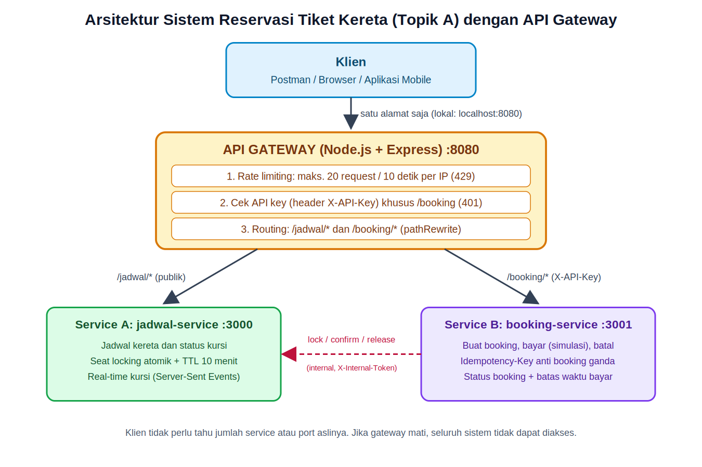

# Sistem Reservasi Tiket Kereta (Topik A) - Lab 08 API Gateway

Praktikum Web Service sesi 08: **API Gateway sederhana (Node.js + Express)** di atas sistem proyek kelompok
(Topik A: reservasi tiket transportasi, versi kereta; ketersediaan kursi real-time dan locking saat booking bersamaan).



## Struktur

```
proyek-kelompok/
├── gateway/            # API Gateway  (port 8080)  <- satu-satunya alamat untuk klien
│   ├── gateway.js
│   ├── package.json
│   ├── test-rate-limit.js            # bukti rate limiting (20x 200, lalu 429)
│   ├── test-concurrent-booking.js    # bukti locking kursi bersamaan
│   └── .env.example
├── jadwal-service/     # Service A (port 3000): jadwal kereta, status kursi, locking, SSE real-time
├── booking-service/    # Service B (port 3001): booking, bayar (simulasi), batal
├── postman/            # koleksi + environment Postman siap impor
├── docs/               # diagram arsitektur (PNG/SVG) + draft refleksi
├── scripts/start-all.js
├── PANDUAN.md          # langkah lengkap: jalankan, Postman, deploy Railway, pengumpulan tugas
└── README.md
```

Pemetaan terhadap modul praktikum: **service-a = jadwal-service**, **service-b = booking-service**
(modul mengizinkan nama diganti sesuai topik kelompok).

## Menjalankan (lokal)

Butuh Node.js 18 atau lebih baru (`node -v`).

```bash
npm run install:all     # install dependensi ketiga project sekali saja
npm run start:all       # jalankan jadwal-service, booking-service, dan gateway sekaligus
```

Atau manual dengan tiga terminal (sesuai modul):

```bash
cd jadwal-service  && npm install && node server.js     # terminal 1 (port 3000)
cd booking-service && npm install && node server.js     # terminal 2 (port 3001)
cd gateway && npm install && cp .env.example .env && node gateway.js   # terminal 3 (port 8080)
```

(Windows PowerShell: ganti `cp` dengan `copy .env.example .env`.)

Klien hanya mengakses **http://localhost:8080**.

## Endpoint (semua lewat gateway :8080)

| Method | Path | Keterangan | API key |
|---|---|---|---|
| GET | `/` | Info gateway | tidak |
| GET | `/health` | Health check | tidak |
| GET | `/jadwal/` | Daftar perjalanan + jumlah kursi tersedia | tidak |
| GET | `/jadwal/:id` | Detail perjalanan (`KA-001`, `KA-002`, `KA-003`) | tidak |
| GET | `/jadwal/:id/kursi` | Peta 40 kursi (AVAILABLE / LOCKED / BOOKED) | tidak |
| GET | `/jadwal/:id/kursi/stream` | Real-time kursi (Server-Sent Events) | tidak |
| GET | `/booking/` | Daftar booking (`?status=LUNAS`) | **ya** |
| POST | `/booking/` | Buat booking dan kunci kursi (header opsional `Idempotency-Key`) | **ya** |
| GET | `/booking/:id` | Detail booking | **ya** |
| POST | `/booking/:id/bayar` | Bayar (simulasi), kursi menjadi BOOKED | **ya** |
| POST | `/booking/:id/batal` | Batalkan, kursi dilepas | **ya** |

Contoh body `POST /booking/`:

```json
{ "perjalananId": "KA-002", "kursi": ["3A", "3B"], "penumpang": { "nama": "Budi Santoso" } }
```

Kode status: `201` berhasil, `400` input salah, `401` API key salah/tidak ada, `404` tidak ditemukan,
`409` kursi bentrok / status tidak sesuai, `410` batas bayar lewat, `429` kena rate limit, `504` service tujuan mati.

## Variabel lingkungan

| Project | Variabel | Keterangan |
|---|---|---|
| gateway | `PORT` | default 8080 (di hosting diisi otomatis) |
| gateway | `SERVICE_A_URL` | URL jadwal-service (default `http://localhost:3000`) |
| gateway | `SERVICE_B_URL` | URL booking-service (default `http://localhost:3001`) |
| gateway | `API_KEY` | key untuk route `/booking` (wajib diisi) |
| booking-service | `JADWAL_URL` | URL jadwal-service (default `http://localhost:3000`) |
| booking-service, jadwal-service | `INTERNAL_TOKEN` | token rahasia antar-service (harus sama di keduanya) |
| jadwal-service | `LOCK_TTL_MS` | masa berlaku lock kursi, default 600000 (10 menit) |

Jangan commit `.env` (sudah ada di `.gitignore`). Hanya `.env.example` yang boleh masuk repository.

## Bukti untuk tugas

```bash
cd gateway
node test-rate-limit.js          # 20 baris "200" lalu 10 baris "429"  -> screenshot
node test-concurrent-booking.js  # tepat 1 yang 201, sisanya 409       -> bukti locking (bonus)
```

Jika menjalankan `test-rate-limit.js` berulang, tunggu lebih dari 10 detik di antaranya.

## Catatan desain

- **Locking atomik**: pemeriksaan "semua kursi kosong" lalu "kunci" di `jadwal-service` berjalan sinkron (tanpa `await`)
  di Node.js single-thread, sehingga dua booking bersamaan ke kursi yang sama tidak mungkin sama-sama berhasil.
- **TTL 10 menit** (sesuai rancangan keamanan kelompok). Lock yang tidak dibayar otomatis dilepas.
- **Idempotency-Key** mencegah booking ganda saat klien mengirim ulang request.
- Route `/jadwal/internal/*` diblokir di gateway dan juga dilindungi `X-Internal-Token` di service.
- Data disimpan **in-memory**: data hilang saat service restart, dan service harus berjalan **1 instance**.
  Untuk UAS, ganti dengan database/Redis agar state kursi tahan restart dan bisa di-scale.
